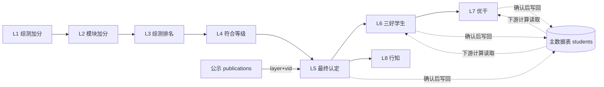
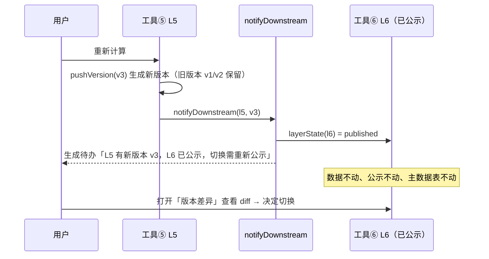
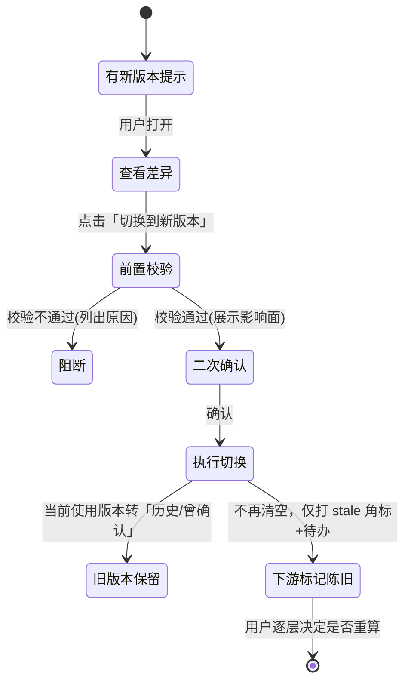

# 评奖评优工作台 · 上下游数据依赖与版本化重构设计方案

> 目标：把"上游重算 → 下游级联失效清空"改成"上游版本化留存 → 下游按引用版本号固化读取 → 新版本仅提示、由用户决策切换"，保证**已锁定、已公示的数据不被上游再次计算破坏**。
> 适用版本：2.5.1（sha256 `52fb5617…`）；本文所有字段名、函数名均可在 `index.html` 中定位到现有实现。

---

## 0. 现状与问题定位

### 0.1 现状链路



关键现状（代码位置）：

| 机制 | 位置 | 说明 |
|---|---|---|
| 版本表 | `stage.lX = {versions:[{vid,at,confirmedAt,by,summary,data}], activeVid}` | 每层独立，`vid = "v"+序号` |
| 上游引用 | 版本 `summary` 里零散记录：`l4Vid`、`l5Vid`、`clsMissing`… | **无统一 `baseRefs`，无法固化整条引用链** |
| 确认写回 | `applyLXVersion()` → `L*_KEEP.forEach(k=>s[k]=r[k])` | 确认后把结果写进主数据表 |
| 下游读取 | `calcSanhao()` 等读 `s["最终评定奖学金"]`、`s["班级排名"]`… | **读的是主数据表当"当前值"，不是上游版本快照** |
| 级联失效 | `invalidateDownstream(b,layer)` | 上游切换 → 下游 `versions=[]` + `activeVid=null` + 重算待办（**整层删除**） |
| 公示 | `publications[] = {id,layer,vid,cols,…}` + `encodePubPayload` 内嵌数据快照 | 公示已绑定 `layer+vid`，且 payload 自带快照，本身是"冻结"的 |

### 0.2 三个根因问题

1. **覆盖式失效**：`invalidateDownstream` 直接把下游 `versions` 清空——历史版本、已确认结果、对外承诺一并消失；用户无法"先看完差异再决定"。
2. **单一真相源错位**：下游计算读主数据表，而主数据表是"最后一次确认"的投影；上游重算虽不立刻改主表，但一旦下游被清空重算，主表就被覆盖。
3. **引用未固化**：下游没有显式记录"我用的是上游哪个版本"，只有 `activeVid` 指向**最新使用版本**，缺少"已锁定/已公示则钉死"的语义。

### 0.3 设计要解决的边界

- 已公示数据：公示 payload 已自快照，但**工作台内的对外口径**必须与公示一致（导出、查询页、异议复核）。
- 已锁定数据：当前只有 `confirmedAt`（确认选定），需要新增"锁定"语义（防误改）。
- 未锁定数据：允许配置"自动跟随最新上游版本"。

---

## 1. 设计目标与原则

| 原则 | 含义 | 落地约束 |
|---|---|---|
| 版本不可变 | 版本一经生成，其 `data` 只读，永不改写 | 重算只 push 新版本，不修改旧版本 |
| 引用即快照 | 下游记录 `baseRefs`（各上游层的 vid），读取时按 vid 取快照 | 下游计算输入 = 上游版本快照 ∪ 信息库字段 |
| 锁定即冻结 | 已锁定/已公示的下游版本，任何上游变化都不自动改动 | 只允许显式"解锁 → 切换 → 重算 → 重新公示" |
| 切换需显式 | 新版本只产生提示与差异，不产生副作用 | 除 `policy=auto` 且未锁定的层外，一律不自动改 |
| 可回溯可审计 | 每次切换留痕（谁、何时、从哪版到哪版、影响哪些层） | 写入 `version.switchLog` 与 `batch.audit` |
| 默认安全 | 默认 `manual`；自动跟随只对"未确认且未公示"的下游生效 | 配置显式开启 |

---

## 2. 数据模型设计

### 2.1 版本表（已有，扩展字段）

```
batch.stage.lX = {
  versions: [ Version, ... ],      // 有序，索引即版本号顺序
  activeVid: "v3" | null           // 当前"使用版本"（下游引用的就是这个）
}
```

`Version`（新增字段用 ★ 标记）：

| 字段 | 类型 | 说明 |
|---|---|---|
| `vid` | string | 版本标识，保持 `v1/v2/…`（存量兼容） |
| `at` | ISO | 生成时间 |
| `by` | string | 计算人（`ROLES[state.role]`） |
| `confirmedAt` | ISO/null | 确认（选定使用）时间 |
| `confirmBy` ★ | string | 确认人 |
| `summary` | object | 摘要（人数/通过数/规则文本等，既有字段保留） |
| `baseRefs` ★ | object | **核心**：`{l1:"v2", l2:"v1", l3:"v3", l4:"v1", l5:"v2"}`，只记录本层实际依赖的上游层 |
| `data` | array | 快照（不可变） |
| `dataHash` ★ | string | 快照指纹（用于快速判等/防篡改） |
| `diff` ★ | object | 与上一版本的差异摘要（见 §5） |
| `lock` ★ | object/null | `{lockedAt, lockedBy, reason}`，锁定后不可切换/不可被上游影响 |
| `switchLog` ★ | array | `[{at,by,fromVid,toVid,layers:[…],reason}]` |
| `recount` ★ | boolean | 是否因上游切换而重算（便于区分"新算"与"跟随重算"） |

### 2.2 快照（不可变）

- `data` 为**行数组**（每行为该层输出字段，含学号主键），不做引用共享；
- 新增版本时对 `data` 做 `JSON.stringify → hash`（`dataHash`）；
- 快照保留全部审计列（如 L6 的 `系统班级排名 / 班级排名 / 班级排名来源 / 等级来源`），导出与公示都从快照取，保证一致性。

### 2.3 引用关系（核心新增）

```js
/* 依赖图：声明式配置，取代 invalidateDownstream 里的 if 链 */
const LAYER_DEPS = {
  l1: [],                 // 依赖信息库
  l2: ["l1"],
  l3: ["l1","l2"],
  l4: ["l1","l2","l3"],
  l5: ["l1","l2","l3","l4"],
  l6: ["l1","l2","l3","l4","l5"],
  l7: ["l1","l2","l3","l4","l5","l6"],
  l8: ["l1","l2","l3","l4","l5"]      // L5 分支，不依赖 ⑥⑦
};
```

- 每个下游版本在生成时固化 `baseRefs`（逐层取当时的 `activeVid`）；
- 读取：`upstreamSnap(layer, vid)` → 直接从 `stage[layer].versions` 取，不读主数据表；
- **引用解析函数**：`resolveChain(lXvid)` 递归展开，得到"该结果究竟由哪些上游版本算出"的完整链路，供差异与审计使用。

### 2.4 锁定与公示状态（派生 + 显式）

```js
function layerState(b, layer){            // 统一状态机
  const S = stage(b,layer), v = S.versions.find(x=>x.vid===S.activeVid);
  if(!v) return S.versions.length ? "computed" : "empty";   // 已计算待确认 / 空
  if(v.lock && v.lock.lockedAt) return "locked";            // 已锁定（冻结）
  if(isPublished(b, layer, v.vid)) return "published";      // 已公示（对外承诺）
  return "confirmed";                                       // 已确认未锁定
}
function isPublished(b, layer, vid){
  return (b.publications||[]).some(p => p.layer===layer && p.vid===vid && p.status!=="已撤销");
}
```

状态优先级：`empty < computed < confirmed < published < locked`（越靠右越"冻结"）。

### 2.5 待办与提示（扩展）

`todos` 新增两类系统待办（保留既有 `run-lX` / `confirm-lX`）：

| sysKey | 含义 | meta |
|---|---|---|
| `upstream-new` | 上游产生新版本 | `{layer, fromVid, toVid, downstream:["l6"], level:"info"}` |
| `switch-review` | 用户发起切换待复核 | `{layer, toVid, affected:[…], createdAt}` |

- 提示**永不删除下游数据**；一键跳转"版本差异"面板。

### 2.6 差异缓存

```
batch.diffs["l5:v2->v3"] = { at, rowAdd:[], rowDel:[], fieldChanges:[{sid,field,from,to}], summary:{…} }
```
- 生成新版本时同步计算并缓存；切换面板直接读取，避免重复 O(n×m) 比对。

### 2.7 自动跟随策略配置

```
batch.followPolicy = { l2:"manual", l3:"manual", …, l6:"auto", l7:"auto", l8:"manual" }   // 默认 manual
```
- `auto` 仅在**该层未确认、未锁定、未公示**时生效：上游出现新版本 → 自动把 `baseRefs` 指向新版并重算生成新版本（仍不确认，仍需用户点"选定使用版本"）。
- 一旦该层进入 `confirmed/published/locked`，`auto` 自动降级为提示。

### 2.8 存储容量估算

- 单层 60 人 × 约 20 字段 ≈ 60×20×12B ≈ 15KB/版本；8 层 × 平均 3 版本 ≈ 360KB。
- localStorage 上限约 5MB，可接受；建议新增 `batch.versionGC` 策略：仅保留每层最近 N=5 个版本（**已锁定/已公示/已确认版本永不回收**）。

---

## 3. 版本生成链路（改造后）

### 3.1 统一 `pushVersion`（替代各层 `pushLXVersion` 的重复逻辑）

```js
function pushVersion(b, layer, rows, summary, extra){
  const S = stage(b, layer);
  const vid = "v" + (S.versions.length + 1);
  const prev = S.versions[S.versions.length-1] || null;
  const baseRefs = {}; LAYER_DEPS[layer].forEach(d => baseRefs[d] = stage(b,d).activeVid || null);
  const v = { vid, at:new Date().toISOString(), by:ROLES[state.role], confirmedAt:null,
              summary, data: rows.map(r => ({...r})),
              dataHash: hashOf(rows), baseRefs, diff: null, lock:null, switchLog:[],
              ...(extra||{}) };
  v.diff = diffVersions(prev, v, DIFF_KEYS[layer]);          // 与上一版本比对
  S.versions.push(v);
  b.diffs = b.diffs || {};
  if(prev) b.diffs[layer+":"+prev.vid+"->"+v.vid] = v.diff;
  notifyDownstream(b, layer, v);                              // 只提示，不破坏
  return v;
}
```

**要点**：`pushVersion` 内部**不再调用任何失效逻辑**；对下游的影响全部交给 `notifyDownstream` 判定。

### 3.2 `notifyDownstream`（取代 `invalidateDownstream`）

```js
function notifyDownstream(b, upLayer, newV){
  Object.keys(LAYER_DEPS).forEach(dl => {
    if(!LAYER_DEPS[dl].includes(upLayer)) return;            // 非下游
    const st = layerState(b, dl), S = stage(b, dl);
    const usedRefs = activeRefsOf(b, dl);                    // 当前使用版本的 baseRefs
    if(!usedRefs || usedRefs[upLayer] == null) return;       // 还没产出，无需提示
    if(usedRefs[upLayer] === newV.vid) return;               // 已指向新版

    if(st === "empty" || st === "computed"){
      if(followPolicy(b, dl) === "auto"){
        switchBase(b, dl, {[upLayer]: newV.vid}, {auto:true, by:"系统自动跟随"});
        toast(`${LAYER_NAME[dl]} 已跟随上游 ${upLayer} 新版本 ${newV.vid} 自动重算（仍需你确认）`, "clock");
      }else{
        addSysTodo(b, "upstream-new", `上游 ${LAYER_NAME[upLayer]} 产生新版本 ${newV.vid}，${LAYER_NAME[dl]} 可切换`,
                   TOOL_OF[dl], {upLayer, toVid:newV.vid, fromVid:usedRefs[upLayer], mode:"can-switch"});
      }
      return;
    }
    // confirmed / published / locked：只提示，绝不自动改
    const level = st === "locked" ? "locked" : st === "published" ? "published" : "confirmed";
    addSysTodo(b, "upstream-new",
      `${LAYER_NAME[dl]} 引用的上游 ${upLayer} ${usedRefs[upLayer]} 已有新版本 ${newV.vid}` +
      (level==="published" ? "（该层已公示，切换需重新公示）" : level==="locked" ? "（该层已锁定，需先解锁）" : ""),
      TOOL_OF[dl], {upLayer, fromVid:usedRefs[upLayer], toVid:newV.vid, mode:"review-only", level});
    markStale(b, dl, upLayer, newV.vid);                     // 打"上游有新版本"角标
  });
}
```

### 3.3 时序（上游重算 → 下游只提示）



---

## 4. 版本读取链路（改造后）

### 4.1 下游不再读主数据表

```js
/* 下游计算输入 = 上游版本快照 ∪ 信息库字段（学号主键） */
function buildInputView(b, layer, baseRefs){
  const idx = {};
  (b.students||[]).forEach(s => idx[normSid(s["学号"])] = {...s});      // 信息库（身份/资格/体育等）
  LAYER_DEPS[layer].forEach(d => {
    const v = findVersion(b, d, baseRefs[d]);
    if(!v) throw new Error(`缺少上游 ${d} 版本 ${baseRefs[d]}`);
    v.data.forEach(r => Object.assign(idx[normSid(r["学号"])] ||= {}, pickKeep(r, L_KEEP[d])));
  });
  return Object.values(idx);
}
```

- `calcSanhao / calcGanbu / calcXingzhi` 等改为 `buildInputView(b, "l6", baseRefs)` 取输入，`baseRefs` 由**当前正在生成的版本**固化；
- 彻底消除"主数据表当中间态"的耦合。

### 4.2 主数据表降级为"对外投影"

- 主数据表只在**下游确认（选定使用版本）时**同步一次，并记录来源：
  `batch.mainFrom = { l5:"v2", l6:"v1", l7:"v1", l8:"v1", at, by }`
- 信息库字段（体育成绩、是否挂科等）仍直接维护在主数据表，不参与版本化；
- 导出/公示/查询页一律取 `stage[l].versions[vid].data`，保证与版本一致。

### 4.3 兼容旧数据

```js
function migrateBatch(b){
  // 1) 补 baseRefs：从 summary.l4Vid/l5Vid 等回填，缺失则填当时 activeVid 或 null
  // 2) 补 dataHash / diff=null / lock=null / switchLog=[]
  // 3) followPolicy 默认全 manual
  // 4) publications 原样保留（已自快照）
  // 5) 标记 b.schemaVersion = 2
}
```
迁移在载入批次时惰性执行（`loadBatch` 后 `if(b.schemaVersion<2) migrateBatch(b)`），失败不影响使用。

---

## 5. 差异检测设计

### 5.1 三级差异

```js
const DIFF_KEYS = {
  l5: ["最终评定奖学金","班级排名","综测排名比例"],
  l6: ["是否符合三好学生","班级排名","学年综测班级排名比例","最终评定奖学金"],
  l7: ["是否符合优秀学生干部","学年综测班级排名比例","品德测评班级排名比例"],
  l3: ["综测总成绩","班级排名","同年级同专业同类型排名"]
  /* …其余层按输出字段配置 */
};

function diffVersions(prevV, nextV, keys){
  if(!prevV) return {baseline:true};
  const a = indexBy(prevV.data), c = indexBy(nextV.data);
  return {
    rowAdd: Object.keys(c).filter(k=>!(k in a)),
    rowDel: Object.keys(a).filter(k=>!(k in c)),
    fieldChanges: keys.flatMap(f => Object.keys(c).filter(k=>k in a && !eq(a[k][f], c[k][f]))
                                     .map(k => ({sid:k, field:f, from:a[k][f], to:c[k][f]}))),
    summaryDelta: deltaOf(prevV.summary, nextV.summary),   // 人数/通过数/等级分布
    hashChanged: prevV.dataHash !== nextV.dataHash
  };
}
```

| 级别 | 输出 | 用户价值 |
|---|---|---|
| 行集级 | 新增 N 人 / 减少 N 人（列学号） | 判断参评名单是否变化（最关键） |
| 字段级 | 逐学号字段 `from → to`（Top 20 + 可导出全量） | 定位"谁的结果变了、变在哪" |
| 汇总级 | 人数、通过/符合数、各等级人数、规则文本 | 一眼判断影响面 |

### 5.2 差异严重度分级（决定提示样式）

| 级别 | 判定 | 展示 |
|---|---|---|
| `none` | hash 相同 | "内容无变化" |
| `low` | 仅汇总微变、无名单进出、关键字段无变化 | 灰色提示 |
| `medium` | 有字段变化但无名单进出 | 黄色"建议复核" |
| `high` | 有名单进出，或关键字段（最终认定/是否符合）变化 | 红色"必须复核"+ 列出受影响学生 |
| `blocking` | 下游已公示/已锁定 | 红色 + "切换需重新公示 / 先解锁" |

---

## 6. 提示用户切换：展示信息与前置校验

### 6.1 版本差异面板必须展示的信息

1. **版本身份**：`L5 v2（当前引用，2026-09-15 王辅导员确认） → L5 v3（2026-09-17 09:12 由李管理员计算）`
2. **上游链路**：本次 v3 自身的 `baseRefs`（L4 v3 / L3 v2 …），以及它是**因哪一层变化而重算**的
3. **变更摘要**：人数、符合/通过数、等级分布前后对比
4. **名单进出**：新增/减少的学号与姓名（若有，红色置顶）
5. **关键字段变化明细**：学号 / 姓名 / 班级 / 字段 / 原值 / 新值（默认 Top 20，支持"导出全部差异 CSV"）
6. **受影响下游链**：`L5 → L6（已公示）→ L7（已确认）`、`L5 → L8（未确认，policy=manual）`
7. **对外影响**：命中公示的标题、公示期、短链、已发布异议条数
8. **建议动作**：保持原样 / 切换并重算 / 先解锁 / 重新公示

### 6.2 切换前的前置校验清单（逐项通过才允许"确认切换"）

| # | 校验项 | 不通过的处理 |
|---|---|---|
| 1 | **下游状态**：目标下游是否 `locked` | 要求先解锁（记录解锁原因与操作人） |
| 2 | **公示一致性**：是否命中 `publications` | 提示"切换后需重新生成公示链接；旧短链仍指向旧快照"，并展示受影响的公示标题/期数/异议数 |
| 3 | **名单一致性**：新版本相对当前引用的 `rowAdd/rowDel` | 列出学号；非空时要求勾选"我已知悉名单变化" |
| 4 | **覆盖度**：新版本输出行数 ≠ 参评人数 | 阻断并提示"结果不完整，不能切换" |
| 5 | **名额/配额有效性**（L5 相关）：名额表是否被上游人数变化击穿 | 提示"需复核名额表"，并要求确认 |
| 6 | **连锁下游可重算性**：被影响层是否存在"缺失字段"（如体育成绩、是否学生干部） | 列出缺失项与跳转补齐入口 |
| 7 | **权限**：切换 + 已公示变更需管理员角色 | 辅导员角色仅能提交"切换申请"待办 |
| 8 | **留痕**：填写切换原因（≥6 字） | 空原因不允许提交 |
| 9 | **二次确认**：展示影响面摘要后点击"确认切换并失效下游" | 未点击不落库 |

### 6.3 切换流程（状态机）



执行切换的核心动作（**与旧逻辑的差异：不再 `versions=[]`**）：

```js
function switchBase(b, dl, newRefs, opt){
  const S = stage(b, dl), cur = S.versions.find(x=>x.vid===S.activeVid);
  assertSwitchable(b, dl, newRefs);                    // §6.2 九项校验
  if(cur){                                             // 旧版本保留，仅取消"使用中"
    cur.unactiveAt = new Date().toISOString();
    cur.switchLog.push({at:new Date().toISOString(), by:ROLES[state.role],
      fromRefs:cur.baseRefs, toRefs:newRefs, reason:opt.reason});
  }
  const nv = pushVersion(b, dl, recalcRows(b, dl, newRefs), summarize(…), {recount:true, baseRefs:{...cur?.baseRefs, ...newRefs}});
  S.activeVid = nv.vid;                                // 切换后仍需用户确认（保持确认门禁）
  markStaleDownstream(b, dl);                          // 下游只打角标 + 待办，不清数据
  audit(b, "switch-base", {layer:dl, from:cur?.vid, to:nv.vid, reason:opt.reason});
}
```

### 6.4 自动跟随配置（UI）

- 位置：每层工具页"版本与依赖"卡片 + 全局「数据与工具 → 版本策略」
- 开关：`跟随上游最新版本（仅在本层未确认/未锁定/未公示时自动重算）`
- 开启时展示当前生效条件；一旦该层被确认/公示/锁定，开关自动置灰并提示"已冻结，需手动切换"

---

## 7. 迁移与实施顺序

| 阶段 | 内容 | 风险 |
|---|---|---|
| P0 | 新增 `LAYER_DEPS` / `layerState()` / `migrateBatch()`，只读并行，不改现有行为 | 无 |
| P1 | `pushVersion` 统一化 + `baseRefs`/`dataHash`/`diff` 双写（旧字段保留） | 低 |
| P2 | 下游计算改读 `buildInputView`（灰度：`batch.flags.newRead=true` 才启用） | 中，需回归 8 个工具 |
| P3 | `invalidateDownstream` 替换为 `notifyDownstream`；保留 `flags.legacyCascade` 回滚开关 | 中，行为变更 |
| P4 | 版本差异面板 + 切换校验 + 自动跟随配置 UI | 低 |
| P5 | 公示联动（切换后提示重新公示、旧短链说明）、审计日志 | 低 |
| P6 | 移除旧级联代码与 `flags`；`versionGC` 回收策略 | 低 |

回滚：任一阶段异常 → `batch.flags.legacyCascade=true` 即可退回旧链路（旧代码保留一个版本周期）。

---

## 8. 风险与边界

1. **已发布短链不可变**：公示 payload 内嵌快照，切换上游不会让已发布链接"变内容"；但工作台内口径需与公示一致 → 已公示层禁止静默切换，必须重新生成公示。
2. **手动调整 overrides**（`scholarshipOverrides`）不属于版本数据，而是"计算输入的补充"；它变化时应走"本层重算"而非"上游切换"（现状已实现：保存后自动重算生成未确认版本）。
3. **容量**：版本 GC 必须保护"已确认/已锁定/已公示"版本；导出备份时按 `schemaVersion=2` 导出。
4. **性能**：diff 为 O(n)，60–300 人规模无压力；差异明细渲染分页（Top 20 + 导出）。
5. **并发/多端**：localStorage 单机，无并发写冲突；但需防"切换中刷新页面"——切换落库前用 `save()` 一次性写入，失败可重试。
6. **⑧行知分支**：`LAYER_DEPS.l8 = [l1..l5]`，**不含 l6/l7**，切勿沿用旧 if 链时误加。
7. **审计合规**：所有切换写 `batch.audit`，与 `switchLog` 双写，导出为 CSV 备查。

---

## 9. 验收标准与测试清单

| 类别 | 用例 |
|---|---|
| 版本留存 | 上游连续 3 次重算 → 3 个版本并存，旧版本 `data` 与 `dataHash` 未被改写 |
| 引用固化 | 下游版本 `baseRefs` 记录生成时各上游 vid；上游再算，下游 `baseRefs` 不变 |
| 不覆盖 | 已公示层在上游重算后：`versions` 数量不变、`activeVid` 不变、主数据表不变 |
| 提示 | 生成 `upstream-new` 待办，含 fromVid/toVid/等级；未产生任何数据删除 |
| 差异 | diff 正确识别名单进出、字段变化、汇总变化；`hashChanged=false` 时不提示差异 |
| 自动跟随 | `policy=auto` + 未确认层：上游新版 → 自动重算生成未确认版本；已确认层不自动改 |
| 前置校验 | 9 项逐条构造不通过场景，均被阻断并给出明确原因 |
| 切换 | 切换后旧版本仍在（可查看/下载），新版本未确认，下游仅打角标 |
| 迁移 | 旧批次载入后 `schemaVersion=2`，`baseRefs` 正确回填，8 个工具结果不变 |
| 回归 | 现有 4 套测试（89+82 单测 / 32+32 E2E）全绿；新增依赖链路测试 ≥ 40 条 |

---

## 10. 关键接口一览（建议函数签名）

```js
LAYER_DEPS / LAYER_NAME / TOOL_OF          // 依赖图配置（唯一真相）
stage(b,layer) / findVersion(b,layer,vid)  // 版本存取
layerState(b,layer)                        // empty|computed|confirmed|published|locked
isPublished(b,layer,vid) / lockVersion(b,layer,vid,reason) / unlockVersion(...)
pushVersion(b,layer,rows,summary,extra)    // 唯一生成入口（含 diff + notify）
notifyDownstream(b,upLayer,newV)           // 只提示/自动跟随，不破坏
diffVersions(a,b,keys) / diffSeverity(d)   // 差异与分级
buildInputView(b,layer,baseRefs)           // 下游输入（版本快照 ∪ 信息库）
assertSwitchable(b,layer,newRefs)          // 九项前置校验，返回 {ok, blockers[]}
switchBase(b,layer,newRefs,opt)            // 切换（保留旧版本 + 下游打角标）
markStale(b,layer,upLayer,newVid)          // 角标与待办
migrateBatch(b)                            // 存量升级到 schemaVersion=2
versionGC(b, keepN=5)                      // 回收（保护 confirmed/published/locked）
```

---

**一句话总结**：把"上游重算即下游清零"改成"版本不可变 + 引用固化 + 状态分级冻结 + 差异驱动的用户决策"，上游永远只是"多了一个候选版本"，而已锁定、已公示的数据默认纹丝不动。
